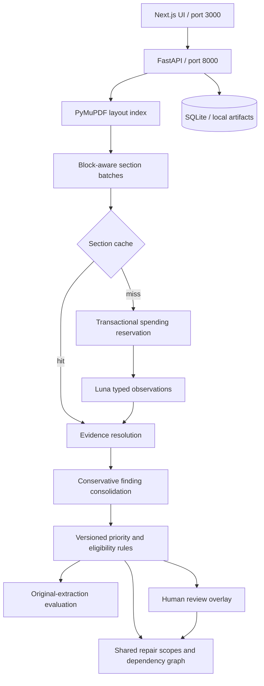

# HouseScope architecture

## Decision boundaries

The model interprets document language. Application code owns evidence identity, state transitions, spending decisions, consolidation rules, prioritization, repair grouping, review history and measurement. A visually polished result is insufficient unless its provenance and failure states remain inspectable.

The browser talks to `/api/*` through a Next.js rewrite. Secrets never enter the frontend bundle. Polling returns report state and stage events every 1.8 seconds while processing; no model call is triggered by polling, review, document browsing, evaluation or export.

## Evidence records

A source record contains physical PDF page, exact quotation, normalized-match result, line bounding boxes, geometry-match result, locally bound inspection reference, declared reference, reference-conflict flag and source severity. A finding contains every source, raw extraction variant, merge reason, versioned decision, review state and provenance.

Word geometry is extracted directly from the PDF. A normalized word stream maps an exact quotation to matching words; their boxes are combined per PDF line. On-demand preview rendering adds temporary highlight annotations to an in-memory PDF page. It never modifies the stored original.

Numbered observation reference binding is format-specific. A conservative continuation adapter can link an unnumbered next-page recommendation when it shares at least two subject terms with the preceding detail heading; evidence records explicitly identify this inference and the parent page. An unfamiliar layout still supports quote and geometry checks but may not support safe summary/detail consolidation. Similar titles are suggestions, not proof of identity. Automatic merges require source validation, and differing interpretations remain visible.

## Decision policies

Safety patterns and inspector immediate-deficiency categories determine initial priorities. Rules operate on matched source text rather than model-written diagnoses. The rule ID and version explain the result. Lexical overlap, negation and boilerplate gates are deliberately limited heuristics; they cannot prove semantic support. A human reads the source, accepts or rejects findings and can explicitly override priority.

Planning assigns a single coordinated scope to each trade category, preserving every linked finding. This prevents repeated electrical diagnostic charges for several electrical defects. It does not pretend to solve contractor estimating. Dimensions, quantities, cause, access and contractor pricing remain explicit unknowns.

Moisture-related tasks demonstrate a topological dependency workflow. Source investigation precedes correction; relevant finish restoration waits for cause resolution. A drainage/moisture link is explicitly an unconfirmed planning hypothesis. No causal diagnosis is inferred from co-occurrence.

## Persistence and review consistency

Report IDs are SHA-256 hashes of original PDF bytes. Layout artifacts have a parser version. Extraction section cache keys include model, prompt, typed schema and payload. Writes use temporary files and atomic replacement so interrupted writes cannot masquerade as complete checkpoints.

Runs and stages have timestamps and terminal states. The single-process background worker resumes by loading successful sections; failed or unknown calls are not automatically retried. At startup, previously running work is marked interrupted. A future production version would use a durable external job queue.

Review events are append-only. The API requires the caller's expected revision and checks it within an immediate SQLite transaction. Conflicting edits return 409 rather than overwriting a newer review. The baseline remains unchanged; the current assessment is baseline plus latest review overlay. Annotation exports carry both sides and the full history.

## Evaluation design

Reference fixtures bind to an exact document hash to prevent scoring the wrong sample. The first dataset labels 24 Kentucky defect/maintenance entries and records a deliberate limitation exclusion. Labels are agent-curated, not independently human-audited.

One-to-one matching prevents duplicate predictions from improving recall. Predictions without a reference match remain false positives; missed labels remain false negatives. Citation localization checks for a matched quotation and coordinates on the labeled detail page, distinguishing a summary-only citation from detailed evidence.

Scores always use original extraction. Human corrections do not silently improve the model score. Review decisions can be exported for later independent annotation, but are not automatically called ground truth. Semantic entailment, priority correctness and complete construction scope accuracy have not been benchmarked.

## Budget boundaries

Before dispatch, the ledger atomically reserves a conservative token-based maximum. Pending reservations count against the same project ceiling as completed usage. Known usage releases the difference; unknown failures retain the reservation. No automatic SDK retries occur. This controls this app's estimated spending using configured prices, not provider-wide billing.

## Deliberate limits

No OCR, image interpretation, licensed pricing database, calibrated confidence, autonomous purchasing, contractor dispatch, multi-user access or distributed job execution is implemented. Source-backed visual inspection, explicit unknowns and measured failures take priority over unsupported claims. Live model-quality results require a deliberate paid extraction, separate from offline pipeline validation.
